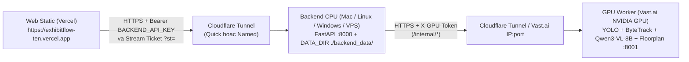

# Hướng dẫn Vận hành ExhibitFlow: Web Vercel → Backend trên mọi máy → GPU Worker Vast.ai

Tài liệu này hướng dẫn chi tiết cách vận hành hệ thống **ExhibitFlow** theo kiến trúc 3 tầng tách biệt:

- **Tầng 1 — Web giao diện tĩnh (`web/`):** Đã được deploy sẵn trên Vercel tại https://exhibitflow-ten.vercel.app (chỉ chứa HTML/CSS/JS, không chứa bí mật hay mã backend).
- **Tầng 2 — Backend CPU (`backend/`):** Chạy FastAPI thuần CPU (không cần `torch`, `cuda`, `opencv`, `ultralytics`) trên **bất kỳ máy nào** (Mac, Linux, Windows, VPS hoặc Docker), mở ra Internet qua Cloudflare Tunnel và lưu toàn bộ SQLite (`state.db`), video tải lên, artifact kết quả tại `DATA_DIR` (mặc định `./backend_data/`).
- **Tầng 3 — GPU Worker (`GPU_server/`):** Chạy độc lập trên **Vast.ai** (khuyến nghị), `--demo` CPU để test nhanh, hoặc **Kaggle** (chỉ thử nghiệm ngắn), tự kiểm tra model sẵn sàng trước khi cấp `Public HTTPS URL` và `X-GPU-Token`.



---

## 1. Web tĩnh trên Vercel (Đã deploy sẵn)

Web giao diện không cần bạn chạy hay build gì thêm — hiện đang hoạt động trực tiếp:

- **URL Production:** https://exhibitflow-ten.vercel.app
- **Alias nhóm (Clevinum):** https://exhibitflow-clevinum.vercel.app
- **Project Vercel:** `exhibitflow` (`prj_HkjSzYcTrLObxEgrjLu6EiRAvfpS`, team `Clevinum` / `team_RgoDwNL7ImhIJygHahzRIzec`)
- **Cấu hình bảo mật đã áp dụng:**
  - `ssoProtection`: `preview` (link production mở công khai cho người dùng, link preview vẫn được Vercel bảo vệ).
  - `0` biến môi trường / `0` secret lưu trên Vercel.
  - Chỉ xuất bản 8 tệp tĩnh (`index.html`, `css/style.css`, `css/theme-light.css`, `js/config.js`, `js/heatmap.js`, `js/hex.js`, `js/museum_analytics.js`, `js/app.js`) cùng `web/vercel.json`.

### Tuỳ chọn: Bật tự động deploy mỗi lần `git push`
Bản hiện tại đã được deploy thẳng từ mã cục bộ. Nếu sau này bạn chỉnh sửa giao diện `web/` và muốn Vercel tự động build lại mỗi khi push code lên GitHub:
1. Push nhánh `Khang` (hoặc merge vào `main`) lên GitHub `https://github.com/potatips/ExhibitFlow`.
2. Vào **Vercel Dashboard → Project `exhibitflow` → Settings → Git / Build and Deployment**:
   - Nối repository `potatips/ExhibitFlow`.
   - Đặt **Root Directory** = `web`.
   - Đặt **Framework Preset** = `Other`.
   - Để trống **Build Command** và giữ **Output Directory** mặc định (`.` hoặc trống).
   - **Không** thêm bất kỳ secret nào vào Environment Variables của Vercel.

---

## 2. Chạy Backend (`backend/`) trên bất kỳ máy nào

Vì `backend/` không phụ thuộc GPU hay thư viện AI nặng, bạn có thể đặt Backend ở bất kỳ máy nào có Python 3.10+ và kết nối Internet. Giữ tiến trình Backend mở trong suốt thời gian sử dụng (khi tắt GPU để tiết kiệm tiền, Backend vẫn cho phép bạn xem lại lịch sử job và duyệt cảnh báo trên web Vercel).

### 2.1. Cài đặt 1 lần trên máy mới

#### Trên macOS / Linux / VPS
```bash
git clone -b Khang https://github.com/potatips/ExhibitFlow.git
cd ExhibitFlow
python3 -m venv .venv
.venv/bin/pip install -r backend/requirements.txt
```

#### Trên Windows (PowerShell)
```powershell
git clone -b Khang https://github.com/potatips/ExhibitFlow.git
cd ExhibitFlow
py -3 -m venv .venv
.venv\Scripts\python.exe -m pip install -r backend\requirements.txt
```

> **Ghi chú:** `backend/launch.py` tự động tải `cloudflared` (vào `<DATA_DIR>/bin`) phù hợp cho Linux (`amd64`/`arm64`), macOS (`.tgz`) và Windows (`.exe`) nếu máy chưa cài sẵn `cloudflared`.

### 2.2. Khởi chạy Backend kèm HTTPS Tunnel

#### Cách 1 — Quick Tunnel (Chạy ngay, không cần tài khoản/domain Cloudflare)
Mỗi lần khởi động lại sẽ sinh một URL ngẫu nhiên `https://*.trycloudflare.com`:

- **macOS / Linux / VPS:**
  ```bash
  cd ExhibitFlow
  CORS_ORIGINS=https://exhibitflow-ten.vercel.app .venv/bin/python backend/launch.py --tunnel quick
  ```
- **Windows (PowerShell):**
  ```powershell
  cd ExhibitFlow
  $env:CORS_ORIGINS="https://exhibitflow-ten.vercel.app"
  .venv\Scripts\python.exe backend\launch.py --tunnel quick
  ```

#### Cách 2 — Named Tunnel (URL cố định trên tên miền riêng)
**Điều kiện:** Bạn đã có tài khoản Cloudflare, một tên miền riêng trỏ DNS về Cloudflare, và đã tạo Tunnel trong **Cloudflare Zero Trust → Networks → Tunnels** trỏ về `http://127.0.0.1:8000` để lấy `CLOUDFLARE_TUNNEL_TOKEN`.

```bash
cd ExhibitFlow
CLOUDFLARE_TUNNEL_TOKEN=<token_cloudflare> \
PUBLIC_BACKEND_URL=https://api.yourdomain.com \
BACKEND_API_KEY=<khoa_api_backend_tu_dat> \
CORS_ORIGINS=https://exhibitflow-ten.vercel.app \
.venv/bin/python backend/launch.py --tunnel named
```

#### Cách 3 — Chạy bằng Docker (VPS / Server)
Image `backend/Dockerfile` chạy `uvicorn app.main:app --host 0.0.0.0 --port 8000` (không kèm sẵn `cloudflared`), phù hợp khi đặt sau reverse proxy HTTPS (Nginx/Caddy/Traefik) hoặc chạy kèm `cloudflared` trên host trỏ vào cổng `8000`:

```bash
docker build -t exhibitflow-backend ./backend
docker run -d --name exhibitflow-backend -p 8000:8000 \
  -v "$(pwd)/backend_data:/app/backend_data" \
  -e DATA_DIR=/app/backend_data \
  -e BACKEND_API_KEY=<khoa_api_backend_tu_dat> \
  -e CORS_ORIGINS=https://exhibitflow-ten.vercel.app \
  exhibitflow-backend
```
Sau đó mở tunnel từ máy host trỏ vào cổng `8000`:
```bash
cloudflared tunnel --no-autoupdate --url http://127.0.0.1:8000
```

### 2.3. Lấy thông tin kết nối Backend
Khi màn hình in **`STATUS: READY (SẴN SÀNG)`**, hãy sao chép 2 giá trị hiển thị trên terminal (không được ghi vào file log):
1. **`Public HTTPS URL`** (ví dụ `https://xxxx.trycloudflare.com` hoặc `https://api.yourdomain.com`).
2. **`Backend Access Key`** (tự sinh ngẫu nhiên nếu không truyền `BACKEND_API_KEY`).

### 2.4. Cách chuyển Backend sang một máy khác
Bạn **không cần sửa hay deploy lại web trên Vercel**:
1. Dừng Backend trên máy cũ (`Ctrl+C`) để SQLite ghi trọn vẹn dữ liệu WAL xuống ổ đĩa.
2. *(Tuỳ chọn — để giữ lại toàn bộ job cũ, video đã upload, floorplan và cảnh báo đã duyệt)* Copy nguyên thư mục `DATA_DIR` (mặc định là `./backend_data/` chứa `state.db` và các artifact cục bộ) sang máy mới.
   - Nếu cấu hình bằng biến môi trường `REDIS_URL` hoặc `ARTIFACT_STORE=vercel_blob` + `BLOB_READ_WRITE_TOKEN`, chỉ cần giữ nguyên các biến môi trường đó trên máy mới.
3. Chạy lại lệnh khởi động ở mục **2.2** trên máy mới (trỏ `--data-dir` / `DATA_DIR` vào thư mục vừa copy nếu khác mặc định):
   - **Nếu dùng Quick Tunnel:** Máy mới tạo `Public HTTPS URL` mới → mở web Vercel → vào **Settings**, dán URL và `Backend Access Key` mới → bấm **Kết nối**.
   - **Nếu dùng Named Tunnel:** Dùng lại đúng `CLOUDFLARE_TUNNEL_TOKEN`, `PUBLIC_BACKEND_URL` và `BACKEND_API_KEY` cũ → URL hoàn toàn không đổi, **không cần chỉnh lại Settings trên web**.
   - **Về cấu hình GPU Worker:** Nếu đã copy `backend_data/state.db`, backend mới tự giữ nguyên URL và `X-GPU-Token` của GPU Worker; nếu chạy `DATA_DIR` trống, chỉ cần dán lại GPU Worker URL + `X-GPU-Token` ở bước 4.

---

## 3. Chạy GPU Worker (`GPU_server/`) trên Vast.ai (và tuỳ chọn khác)

### 3.1. Chạy thật trên Vast.ai (Khuyến nghị)
1. Thuê máy Vast.ai có **NVIDIA GPU** (khuyến nghị **VRAM ≥ 16–24 GB** nếu chạy `MODE=full` kèm VLM `Qwen3-VL-8B`; GPU nhỏ hơn có thể chạy `MODE=tracking_seg` không bật VLM) và chọn template PyTorch/CUDA có sẵn Python/Git.
2. Mở SSH hoặc Jupyter Terminal trên instance Vast.ai và chạy:
   ```bash
   git clone -b Khang https://github.com/potatips/ExhibitFlow.git
   cd ExhibitFlow/GPU_server
   HF_TOKEN=hf_xxx bash start_vast.sh
   ```
   Script `GPU_server/start_vast.sh` sẽ tự động:
   - Kiểm tra GPU và chạy cài đặt idempotent (`make setup`: dependencies, `external/`, tải weights, dựng `llama-server`, map models).
   - Lưu cache HuggingFace ở `/workspace/.hf_home` và dữ liệu job ở `/workspace/gpu_data`.
   - Khởi động worker trên cổng `8001`, đợi tất cả model nạp xong (`models.state == "ready"`).
   - Mở Cloudflare Quick Tunnel HTTPS, tự kiểm tra bên ngoài (đạt `200` khi kèm `X-GPU-Token` và từ chối `401` khi thiếu token), rồi in **`STATUS: READY (SẴN SÀNG)`** cùng **`Public HTTPS`** URL và **`X-GPU-Token`** **một lần duy nhất trên màn hình**.

#### Các tuỳ chọn hữu ích cho `start_vast.sh`
- **Chạy chế độ không cần VLM (nhẹ VRAM hơn):**
  ```bash
  MODE=tracking_seg HF_TOKEN=hf_xxx bash start_vast.sh
  ```
- **Dùng Named Tunnel để có URL GPU cố định:**
  ```bash
  HF_TOKEN=hf_xxx TUNNEL=named CLOUDFLARE_TUNNEL_TOKEN=<token> PUBLIC_GPU_URL=https://gpu.yourdomain.com bash start_vast.sh
  ```
- **Dùng IP:port trực tiếp của Vast.ai (nếu instance có mở port công khai và muốn tắt tunnel):**
  ```bash
  HF_TOKEN=hf_xxx TUNNEL=none PORT=8001 bash start_vast.sh
  ```
  *(Lưu ý: Khi nối với Backend đang chạy cùng TLS/Cloudflare Tunnel, ưu tiên dùng HTTPS tunnel nếu port trực tiếp của Vast.ai là HTTP thuần hoặc bị firewall).*
- **Cố định `X-GPU-Token` qua khởi động lại:** thêm `GPU_TOKEN=<token_tu_dat>` trước lệnh.

### 3.2. Chạy chế độ `--demo` thuần CPU (Test nhanh không tốn GPU)
Dùng trên chính máy Mac/Linux/VPS của bạn để kiểm thử luồng 3 tầng không cần GPU hay weights:
```bash
cd ExhibitFlow
.venv/bin/python GPU_server/launch.py --demo --port 8001
```
Chờ dòng **`STATUS: READY (SẴN SÀNG)`**, lấy **`Public HTTPS`** URL và **`X-GPU-Token`**.

### 3.3. Chạy thử nghiệm ngắn hạn trên Kaggle *(không tương đương Vast.ai)*
Chỉ dùng để demo/chạy thử, **không** dùng làm worker ổn định liên tục vì giới hạn chính thức của Kaggle:
- **GPU miễn phí:** `GPU T4 x2` (P100 đã ngừng).
- **Thời gian & hạn mức:** tối đa **12 giờ/phiên**, tự ngắt sau **20 phút không tương tác (idle timeout)**, hạn mức ~**30 giờ/tuần**.
- **Lưu trữ & mạng:** `/kaggle/working` giới hạn **20 GB** và bị xoá sạch sau khi tắt phiên (chỉ `/kaggle/input/` Kaggle Datasets là bền vững); Quick Tunnel URL đổi mỗi phiên; điều khoản sử dụng chỉ cho mục đích cá nhân phi thương mại.

**Cách chạy nhanh:** Upload notebook `GPU_server/notebooks/exhibitflow_kaggle_worker.ipynb` lên Kaggle, bật **Accelerator: GPU T4 x2** và **Internet: On**, tuỳ chọn gắn Kaggle Dataset weights vào `/kaggle/input/` và khai báo `HF_TOKEN` trong **Add-ons → Secrets**, rồi chạy lần lượt 4 cell (nếu môi trường không build được `llama-server`, đặt `MODE = "tracking_seg"`).

---

## 4. Kết nối 3 tầng trên Web Vercel & Chạy Job

1. Mở https://exhibitflow-ten.vercel.app trên trình duyệt.
2. Chuyển sang tab **Settings**:
   - **Khung 1 — Kết nối máy chủ Backend (CPU FastAPI):**
     - **Bỏ chọn** ô *Chạy trực tiếp trên máy chủ backend (cùng domain / origin)*.
     - Nhập **URL backend** lấy ở Bước 2 (ví dụ `https://xxxx.trycloudflare.com` hoặc `https://api.yourdomain.com`).
     - Nhập **Mã truy cập Backend (API Key)** (`BACKEND_API_KEY`).
     - *(Tuỳ chọn)* Tick *Ghi nhớ mã truy cập sau khi đóng trình duyệt* nếu là máy cá nhân tin cậy (mặc định web chỉ lưu key trong `sessionStorage` của tab/phiên hiện tại).
     - Bấm **Kết nối**.
   - **Khung 2 — Kết nối GPU Worker (Vast.ai / cloudflared):**
     - Nhập **GPU Worker URL** lấy ở Bước 3.
     - Nhập **X-GPU-Token**.
     - Bấm **Lưu & Kiểm tra**. *(Khoá này được gửi lên Backend để Backend uỷ quyền gọi sang GPU Worker, và không bị lưu hay phát lại trong mã frontend.)*
3. Kiểm tra chip trạng thái góc trên giao diện: khi chuyển xanh **`Backend + GPU sẵn sàng`**, hệ thống đã kết nối thông suốt cả 3 tầng.
4. Quay lại **Dashboard**:
   - Tải lên video (job đơn camera hoặc site job đa camera có hiệu chuẩn floorplan) và bấm phân tích.
   - Theo dõi trực tiếp luồng MJPEG, sự kiện, heatmap và cảnh báo.
5. **Xem lại ngoại tuyến (Offline Replay):**
   - Sau khi job hoàn tất và đồng bộ xong về Backend (`DATA_DIR`), bạn có thể **tắt hẳn máy Vast.ai** để tiết kiệm chi phí.
   - Miễn Backend vẫn đang bật, trên web Vercel bạn vẫn xem lại được toàn bộ danh sách job cũ, phát lại video/floorplan, lọc/duyệt cảnh báo và bấm **Xuất CSV**.

---

## 5. Bảo mật & Xử lý sự cố thường gặp

### Nguyên tắc bảo mật bắt buộc
- **Không dùng `--no-auth`** khi mở `backend/launch.py` ra Internet qua tunnel.
- **`BACKEND_API_KEY` ≠ `X-GPU-Token`:** Hai khoá tách biệt hoàn toàn; Backend từ chối `401` nếu ai đó gửi `X-GPU-Token` để đăng nhập Backend.
- **Không đưa bí mật vào frontend, Git hay log:** Không đặt `GPU_TOKEN`, `HF_TOKEN`, `BACKEND_API_KEY` hay `CLOUDFLARE_TUNNEL_TOKEN` vào `web/`, biến môi trường Vercel, hay file cấu hình công khai. Trình khởi chạy đã lọc bí mật khỏi `--log-file`.

### Các lỗi thường gặp và cách xử lý nhanh

| Triệu chứng trên Web / Terminal | Nguyên nhân | Cách khắc phục |
|---|---|---|
| Banner báo mất kết nối Backend / `ERR_CONNECTION` sau khi restart máy Backend | Dùng `--tunnel quick` nên URL `https://*.trycloudflare.com` đã đổi mới | Copy **Public HTTPS URL** mới trên terminal Backend → vào **Settings → Kết nối máy chủ Backend** dán lại và bấm **Kết nối** (hoặc chuyển sang `--tunnel named`). |
| Web báo **CORS** / không kết nối được tới Backend từ Vercel | `CORS_ORIGINS` của Backend thiếu origin của trang Vercel | Khởi động lại Backend kèm `CORS_ORIGINS=https://exhibitflow-ten.vercel.app`. |
| Lỗi **`401 Unauthorized`** khi kết nối Backend hoặc xem luồng | Thiếu/sai `BACKEND_API_KEY`, hoặc nhập nhầm `X-GPU-Token` vào ô API Key Backend | Copy đúng `Backend Access Key` từ terminal `backend/launch.py` dán vào ô **Mã truy cập Backend (API Key)**; `X-GPU-Token` chỉ nhập ở khung **Kết nối GPU Worker**. |
| Chip báo **GPU ngoại tuyến** nhưng lịch sử cũ vẫn xem được | GPU Worker trên Vast.ai đã tắt, hết tiền/hết phiên, hoặc đổi URL Quick Tunnel | Kiểm tra terminal Vast.ai; nếu mới bật lại Vast.ai với Quick Tunnel, dán GPU Worker URL + `X-GPU-Token` mới vào **Settings → Lưu & Kiểm tra**. |
| Tiến độ chạy mượt nhưng SSE báo ngắt/trễ qua `trycloudflare.com` | Cloudflare Quick Tunnel giới hạn kết nối SSE kéo dài (`ReadTimeout`) | Bình thường: giao diện tự động fallback sang polling 5 giây (`sseFallbackPolling`) và MJPEG vẫn hoạt động; nếu cần SSE push chuẩn, hãy dùng **Named Tunnel**. |
| `llama-server` / VLM lỗi thiếu VRAM trên Vast.ai | GPU dưới 16 GB VRAM khi chạy `MODE=full` | Thuê GPU ≥ 16–24 GB VRAM hoặc chạy `MODE=tracking_seg bash start_vast.sh`. |
